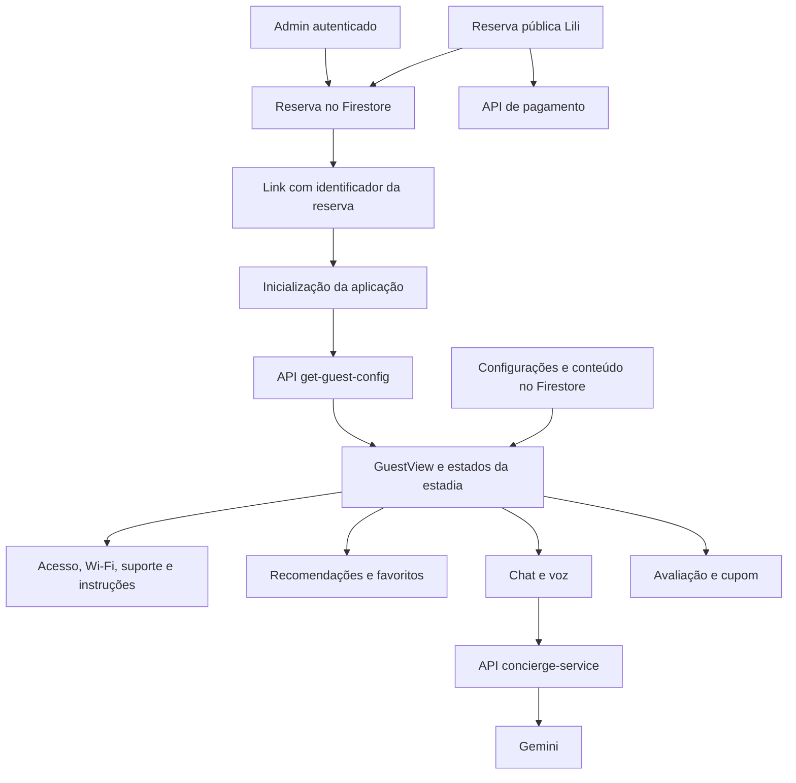

# Auditoria do sistema de guia do hóspede

Data: 04/10/2026. Código de referência: `ed949220357f3a6b7eb257c1a9594cb6f15c7a52`.

## Parecer

O sistema já oferece uma jornada ampla: entrada por reserva, instruções de acesso, estados da estadia, recomendações, atendimento, voz, favoritos, avaliação e administração de duas propriedades. A separação em hooks, serviços e componentes ajuda a compreender e evoluir o produto.

A proteção dos dados é o principal problema. Há **três achados críticos no código**: configurações sensíveis legíveis sem autenticação, um endpoint que devolve a chave do Gemini e liberação de credenciais sem validar cancelamento, revogação ou expiração da reserva. A interface aplica parte dessas restrições, mas isso não protege as APIs nem a leitura direta do Firestore. Os dois comportamentos de API foram reproduzidos com dados fictícios; as regras foram examinadas no repositório, sem consultar documentos reais.

O build completo passa. A cadeia de qualidade está quebrada: testes e lint falham, e o CI chama um script inexistente. Há também inconsistências entre propriedades e barreiras de acessibilidade em ações essenciais. Recomendo tratar os bloqueadores de segurança antes de ampliar funcionalidades ou refinar o visual.

**Escopo e limite:** auditoria do código, configuração versionada, dependências instaladas, testes e navegação local simulada. Não é uma certificação de produção. Não foram consultados hóspedes reais, alteradas reservas, enviadas mensagens, cobrados pagamentos, usadas chaves reais ou modificadas regras publicadas. Nenhum arquivo da aplicação foi corrigido nesta auditoria; foram adicionados apenas este relatório e as evidências.

## 1. Como o sistema funciona



### Aplicação e superfícies

| Parte              | Responsabilidade                                                                          | Fonte principal                                                                                  |
| ------------------ | ----------------------------------------------------------------------------------------- | ------------------------------------------------------------------------------------------------ |
| App                | Escolhe landing, guia, administração, CMS e estados de bloqueio                           | [App.tsx](C:/projetos-eximus/Flats-Integracao/src/App.tsx)                                       |
| Inicialização      | Resolve rota/código, recupera último link e valida bloqueios na interface                 | [useAppInitialization.ts](C:/projetos-eximus/Flats-Integracao/src/hooks/useAppInitialization.ts) |
| Entrada manual     | Aceita código ou URL e carrega a configuração                                             | [useManualAuth.ts](C:/projetos-eximus/Flats-Integracao/src/hooks/useManualAuth.ts)               |
| API da reserva     | Busca reserva pelo documento ou `shortId`, seleciona campos e mascara credenciais futuras | [get-guest-config.ts](C:/projetos-eximus/Flats-Integracao/api/get-guest-config.ts)               |
| Guia               | Combina estadia, dados, tema, modais e recomendações                                      | [GuestView.tsx](C:/projetos-eximus/Flats-Integracao/src/components/GuestView.tsx)                |
| Estados da estadia | Calcula fase, horários e liberação visual                                                 | [useGuestStay.ts](C:/projetos-eximus/Flats-Integracao/src/hooks/useGuestStay.ts)                 |
| Conteúdo           | Carrega imagens e assina locais, dicas, configurações, sugestões e curiosidades           | [useGuestData.ts](C:/projetos-eximus/Flats-Integracao/src/hooks/useGuestData.ts)                 |
| Administração      | CRUD de reservas, conteúdo, configurações, permissões e operação corporativa              | `src/components/admin`, `src/services/firebase`                                                  |

Stack instalada: React 19.2.3, TypeScript 5.9.3, Vite 7.3.3, Firebase 10.14.1, Firebase Admin 13.10.0, funções Vercel, Gemini e Mercado Pago. A compilação também faz SSR/prerender das páginas públicas; isso não equivale a renderizar o guia personalizado no servidor.

### Rotas e identidade do hóspede

| Entrada                        | Comportamento observado ou implementado                                                          |
| ------------------------------ | ------------------------------------------------------------------------------------------------ |
| `/ABC123`                      | Código alfanumérico de seis caracteres abre o guia da reserva                                    |
| `?rid=...`                     | É reconhecido pela inicialização, mas `/?rid=...` acaba mostrando a landing; defeito reproduzido |
| Código/URL manual              | Chama a mesma API, porém não repete a validação de revogação/expiração da inicialização          |
| `/admin`, `/cms`               | Superfícies administrativas, sujeitas ao login/permissões                                        |
| `/lili`, `/flat-lili`          | Landing do Flat Lili                                                                             |
| `/`, `/guia`, páginas públicas | Rotas de marketing/conteúdo; alguns caminhos também podem recuperar o último `rid` local         |

O link funciona como uma credencial de acesso: possuir o identificador basta para consultar a API. Não há sessão autenticada do hóspede. O último código fica em `localStorage` (`flat_lili_last_rid`). A inicialização remove os parâmetros da URL com `replaceState`, inclusive o `rid`.

### Propriedades

| Regra            | Flat Lili                 | Flats Integração                                                    |
| ---------------- | ------------------------- | ------------------------------------------------------------------- |
| Acesso           | Fechadura digital e cofre | Chave física e cofre                                                |
| Recepção         | Não                       | Sim                                                                 |
| Check-in padrão  | 15h                       | 15h                                                                 |
| Checkout padrão  | 11h                       | 13h                                                                 |
| Unidades         | Modelo do Flat Lili       | 201, 202, 301, 302, 303, 304, 401, 402, 403, 404                    |
| Tema do guia     | Roxo/dourado              | Azul/ciano                                                          |
| Stories de dicas | Habilitados               | Configurados como desabilitados, mas a tela ignora esse sinalizador |

A diferenciação existe, mas não atravessa todos os componentes: endereço/unidade do motorista, destino de avaliação, configurações gerais e conteúdo ainda têm valores globais ou herdados do Lili. `PRODUCT.md` e `DESIGN.md` orientam a landing pública; não foram usados como uma exigência de identidade visual para o guia.

### Ciclo da estadia

`useGuestStay` calcula `pre_checkin`, `checkin`, `middle`, `pre_checkout`, `checkout` e `post_checkout`, incluindo tratamento de estadia de uma noite. Os cartões de check-in/checkout orientam o hóspede; não registram, por si, a transição operacional da reserva no banco.

A API libera credenciais a partir da meia-noite do **dia anterior ao check-in**, sem considerar o horário de entrada. A interface faz outro cálculo, tenta consultar WorldTime e cai no relógio local se a consulta falhar. A inicialização considera expiração após o checkout mais um dia, ao fim desse dia. Essa tolerância só é aplicada nessa entrada da interface. A API não possui limite superior de validade e a entrada manual não aplica a tolerância.

Essas regras precisam ser decididas como política de negócio única: data/hora exata de liberação, estados elegíveis, prazo final e comportamento em falha. A auditoria registra o comportamento atual sem assumir qual deveria ser a política comercial.

### Dados e integrações

| Fonte                       | Conteúdo e observações                                                                                                                |
| --------------------------- | ------------------------------------------------------------------------------------------------------------------------------------- |
| `reservations`              | Nome, datas, horários, propriedade, unidade, códigos, alertas, estado e `shortId`; leitura direta restrita ao admin nas regras locais |
| `app_config/general`        | Wi-Fi, cofre, configurações e templates; leitura pública nas regras locais, inclusive campos sensíveis                                |
| `places`, `tips`, `reviews` | Conteúdo público; escrita permitida a qualquer usuário autenticado, sem exigir papel administrativo                                   |
| `admin_users`               | Papel e propriedades autorizadas; escrita depende de superadmin                                                                       |
| Conteúdo estático           | Recomendações, imagens e textos de fallback; parte ainda específica do Lili                                                           |
| Favoritos                   | Persistência local global; sincronização por reserva não fecha com o contrato atual da API                                            |
| WorldTime/clima             | Dependências externas com fallback; não são uma autoridade para controle de acesso                                                    |
| QR de Wi-Fi                 | Serviço externo recebe SSID e senha para gerar a imagem                                                                               |
| Gemini                      | Chat, voz/transcrição do navegador, tradução e TTS em diferentes caminhos de API                                                      |
| Mercado Pago                | Reserva pública/pagamento adjacente ao guia; integração incompleta no código examinado                                                |
| n8n/WhatsApp                | Quatro exports locais, todos com `active: false`; isso não comprova o estado de uma instalação remota                                 |

### Superfície de API

| Endpoint            | Situação relevante                                                                                                               |
| ------------------- | -------------------------------------------------------------------------------------------------------------------------------- |
| `get-guest-config`  | Zod e limite de 30 requisições/minuto por IP, com KV quando configurado; falta validar ciclo de vida e impedir cache de segredos |
| `gemini-key`        | Devolve a chave de ambiente sem autenticação; crítico mesmo que o widget legado não seja usado                                   |
| `concierge-service` | Caminho usado pelo chat; aceita prompt, histórico e nome enviados pelo navegador sem validar reserva, limites ou propriedade     |
| `ai-chat`           | Tem validação e limite próprios, mas não é o caminho principal do widget atual                                                   |
| `chat-v2`           | Caminho alternativo, com contrato/SDK diferente                                                                                  |
| `translate`, `tts`  | Consomem serviços pagos sem autorização/cotas suficientes no código                                                              |
| `create-payment`    | Aceita valor do cliente; referência de webhook sem implementação correspondente encontrada                                       |

Ter validação em um endpoint alternativo não protege o endpoint efetivamente usado. CORS também não substitui autenticação ou autorização.

## 2. Validações executadas

| Verificação                               | Resultado                                                         | Interpretação                                                                                  |
| ----------------------------------------- | ----------------------------------------------------------------- | ---------------------------------------------------------------------------------------------- |
| Build completo                            | Passou                                                            | TypeScript, Vite client/SSR, prerender, sitemap e otimização de CSS concluíram                 |
| Vitest no ambiente padrão                 | 44 arquivos; 156 passaram, 145 falharam; 26 arquivos falharam     | Falta configuração de DOM/setup, além de problemas de mocks/contratos                          |
| Vitest com configuração diagnóstica jsdom | 44 arquivos; 241 passaram, 98 falharam; 20 arquivos falharam      | Configuração isolada da auditoria; continuam falhas em mocks, providers e expectativas antigas |
| ESLint                                    | 6 erros, 17 avisos                                                | Erros impedem a etapa de lint; `api/**` e `public/**` estão excluídos                          |
| CI                                        | `npm run test:ci` sem script correspondente                       | Pipeline não consegue executar essa etapa como versionado                                      |
| `npm audit --omit=dev`                    | 29 pacotes sinalizados: 1 crítico, 6 altos, 21 moderados, 1 baixo | Inclui achados transitivos e metadados propagados; não equivale a 29 explorações demonstradas  |
| Detector de UI Impeccable                 | 13 sinais                                                         | Heurísticas revisadas manualmente; não foram tratados como 13 defeitos confirmados             |
| Probes de API                             | Falhas críticas reproduzidas com mocks                            | Não usaram Firestore, chaves ou reservas reais                                                 |
| Chrome local                              | 320, 390 e 1440 px; temas/fases selecionados                      | Navegação, DOM e capturas com rede/dados simulados                                             |

Os testes padrão e os testes com jsdom não têm o mesmo total porque falhas de importação/setup impedem a coleta de parte das suítes no primeiro ambiente. As 98 falhas da segunda execução **não são 98 bugs de produção**: há mocks obsoletos (`getFirebaseAuth`, `getFirestoreInstance`, storage), providers ausentes e expectativas que já não correspondem ao contrato. Os testes de `useGuestStay` passaram nesse ambiente. A suíte de favoritos também passou, mas não cobre a incompatibilidade do contrato real da API.

No navegador, foram confirmados: landing indevida em `/?rid=...`, bypass manual de reserva revogada, duas centrais de ajuda simultâneas, chat que não fecha com Escape, ausência de landmark `main` no guia e cinco controles de chat ainda alcançáveis por Tab enquanto fechados. Não houve overflow horizontal nas telas verificadas. A captura do popup de avaliação não produziu URL e foi considerada inconclusiva; o problema de destino da avaliação foi identificado pela leitura dos componentes.

Imagens remotas foram substituídas por placeholders e requisições externas bloqueadas nas simulações. As capturas não medem fidelidade fotográfica, latência real, Core Web Vitals, comportamento de voz em dispositivos reais ou permissões publicadas.

### Tamanho da entrega

Build observado: bundle principal **532,11 kB / 159,69 kB gzip**, chunk de animações **239,62 / 86,88 kB**, `GuestView` **184,53 / 48,23 kB**, `ChatWidget` **17,15 / 6,49 kB**, CSS **242,71 / 32,44 kB**. São tamanhos de artefatos, não a soma do download obrigatório em toda rota. Há separação de chunks, porém ainda é necessário medir a jornada real em celular/rede lenta antes de decidir otimizações.

## 3. Achados priorizados

Prioridades: **P0** crítico, exposição de credenciais/segredos ou falha de controle de acesso; **P1** alto, impacto operacional, segurança ou acesso essencial; **P2** médio, inconsistência, robustez ou qualidade. Confiança **alta** significa código inequívoco e/ou reprodução local; **média** indica impacto dependente de configuração/dados/ambiente não verificados. A prioridade considera o código publicado caso corresponda ao repositório; não afirma ocorrência de incidente.

### P0 — corrigir primeiro

**P0-01 — Configurações sensíveis públicas. Confiança alta no código; publicação não verificada.**

Local: [firestore.rules:92](C:/projetos-eximus/Flats-Integracao/firestore.rules:92), serviços `appSettings`, `GuestView.tsx:240`. A leitura de `app_config` é pública. O documento geral contém `wifiPass` e `safeCode`, e templates podem carregar nome, telefone e observações administrativas. O guia ainda prefere o cofre obtido dessa assinatura pública à resposta mascarada da API. Um leitor não precisa possuir uma reserva para consultar o documento se essas regras estiverem publicadas. **Correção:** separar configurações públicas de segredos/PII, negar leitura pública dos documentos privados e entregar somente os campos autorizados pela API da reserva. Não esconder campos apenas no React. Verificar as regras efetivas; após conter a exposição, avaliar rotação das credenciais expostas.

**P0-02 — Endpoint público entrega a chave Gemini. Confiança alta; reproduzido.**

Local: [api/gemini-key.ts:8](C:/projetos-eximus/Flats-Integracao/api/gemini-key.ts:8). A função retorna `GEMINI_API_KEY` com status 200 sem exigir identidade ou autorização. O probe retornou uma chave fictícia. A ausência de uso do widget legado não elimina o endpoint implantável. **Correção:** remover esse caminho de entrega de chave; manter a chave no servidor ou usar credenciais efêmeras limitadas quando o protocolo exigir. Conferir publicação e exposição antes de definir a rotação da chave real.

**P0-03 — Reserva revogada, cancelada ou expirada recebe credenciais. Confiança alta; reproduzido.**

Local: [api/get-guest-config.ts:175](C:/projetos-eximus/Flats-Integracao/api/get-guest-config.ts:175), [useManualAuth.ts:49](C:/projetos-eximus/Flats-Integracao/src/hooks/useManualAuth.ts:49). A API verifica apenas se chegou a data inicial de liberação. Não verifica `status`, `manualDeactivation` ou prazo final. Probes de reserva ativa, cancelada, revogada e expirada retornaram 200 com fechadura/cofre/Wi-Fi fictícios. A entrada manual converte qualquer resposta válida em modo hóspede, e o bypass de revogação foi reproduzido no navegador. **Correção:** autorização única no servidor, usando estado, propriedade e janela de validade; retornar bloqueio sem segredos. A interface deve consumir o resultado dessa decisão. Firebase Admin ignora as regras de acesso do cliente, portanto a regra de reservas não supre essa validação. [Documentação Firebase](https://firebase.google.com/docs/firestore/security/rules-query).

### P1 — alta prioridade

**P1-01 — Escrita de conteúdo exige apenas login. Confiança alta.** `firestore.rules:145–155` permite a qualquer usuário autenticado modificar dicas, locais e avaliações, sem papel de admin nem propriedade. Isso pode afetar conteúdo e links exibidos ao hóspede. Exigir papel/propriedade e validar campos/URLs; testar usuário comum, gestor de outra propriedade e superadmin.

**P1-02 — Isolamento entre propriedades incompleto. Confiança alta no código; dados remotos não verificados.** `useGuestData.ts:71–80` assina locais/dicas sem `propertyId`; o guia ignora `hasTipsStories`; configurações gerais são compartilhadas. Consultas administrativas do Lili também carregam conjuntos amplos e filtram depois, o que pode ser negado para gestores restritos. Aplicar escopo na consulta e no documento, com fallback legado explícito. Regras do Firestore não filtram resultados: a consulta deve demonstrar que só poderá retornar documentos autorizados. [Documentação Firebase](https://firebase.google.com/docs/firestore/security/rules-query).

**P1-03 — Código curto como único segredo, sem unicidade garantida. Confiança alta.** `generateShortId` em `src/utils/helpers.ts` usa seis caracteres de `Math.random`; `saveReservation` não reserva o código atomicamente; a API usa `limit(1)`. O espaço é de aproximadamente 31 bits, e colisões são ambíguas. Existe rate limit na consulta, mas o fallback por processo não é distribuído e falhas de KV permitem a requisição. Usar token criptográfico longo para autorização, alias curto separado e unicidade atômica; limitar tentativas por IP/token com controle distribuído. Não foi executada enumeração real.

**P1-04 — Consumo de IA sem autorização e cotas no caminho ativo. Confiança alta.** `api/concierge-service.ts:36` aceita nome, histórico e instrução de sistema fornecidos pelo cliente; não valida reserva/propriedade, tamanho, taxa, timeout ou tokens máximos. `translate` e `tts` também precisam de limites e autorização. Isso permite consumo de serviços pagos e instruções arbitrárias. Validar a reserva no servidor, montar a persona/contexto autorizado no servidor, limitar entrada/histórico/saída e aplicar cota; padronizar os endpoints alternativos. Não houve chamada paga na auditoria.

**P1-05 — Pagamento público não representa o valor exibido. Confiança alta para o valor; média para execução Vercel.** [BookingModal.tsx:97](C:/projetos-eximus/Flats-Integracao/src/components/Booking/BookingModal.tsx:97) envia R$ 0,01, enquanto a tela calcula outro total. `create-payment` aceita o valor enviado pelo cliente, sem vinculá-lo a um preço autoritativo de reserva; aponta para um webhook cuja implementação não foi encontrada. “Já paguei” apenas muda a etapa visual. Calcular preço no servidor, vincular reserva/transação, usar idempotência e confirmar por webhook autenticado antes de ativar reserva. A assinatura `default function(Request)` também precisa ser validada no runtime configurado: o handler Web documentado usa outra forma; não houve prova de falha em produção. [Runtime Node Vercel](https://vercel.com/docs/functions/runtimes/node-js).

**P1-06 — CI e testes não oferecem uma barreira confiável. Confiança alta; executado.** `.github/workflows/ci.yml:31` chama `test:ci` inexistente. Há 6 erros de lint e falhas de ambiente/mocks/testes. Configurar oficialmente Vitest DOM/setup, reparar contratos e providers, acrescentar casos significativos de autorização/estado/propriedade e alinhar scripts do CI. Incluir backend e SW em uma verificação apropriada; hoje são excluídos do ESLint. Não interpretar build aprovado como segurança aprovada.

**P1-07 — Dependências de produção com avisos relevantes. Confiança alta para o registro; exposição efetiva não avaliada.** `npm audit --omit=dev` marcou 29 pacotes. `websocket-driver` tem severidade crítica; os altos incluem `@fastify/busboy`, `@grpc/grpc-js`, `form-data`, `react-router`, `sharp` e `undici`. A árvore contém dependências diretas e transitivas; alguns caminhos podem ser somente de build ou serviços não usados. Triar alcance, atualizar versões compatíveis e repetir build/testes. Não aplicar `npm audit fix --force` sem avaliar as mudanças de contrato. Ver [evidência de dependências](C:/projetos-eximus/Flats-Integracao/audits/2026-10-04/dependencies-summary.json) e [advisory crítico](https://github.com/advisories/GHSA-xv26-6w52-cph6).

**P1-08 — Ações essenciais inacessíveis por teclado/leitor de tela. Confiança alta; parcialmente reproduzido.** `HolographicCard` e revelação de acesso usam elementos clicáveis sem semântica de botão; modais não têm contrato consistente de diálogo, foco inicial, contenção/restauração de foco ou Escape. O chat fechado deixa cinco controles no Tab e Escape não o fecha. O guia não tem `main`; há botões de ícone sem nome acessível. Adotar botões semânticos, landmark, rótulos e um primitive de diálogo; desmontar/inertizar painel fechado. Validar percurso de teclado e leitura assistiva no acesso, Wi-Fi e suporte.

**P1-09 — Endereço/unidade e avaliação podem corresponder ao Lili em outra propriedade. Confiança alta no código.** [DriverModeModal.tsx:10](C:/projetos-eximus/Flats-Integracao/src/components/modals/DriverModeModal.tsx:10) ignora `address` e imprime `475B / FLAT 304`. `CheckoutCard.tsx:82` e `PostCheckoutCard.tsx:61` usam `GOOGLE_REVIEW_LINK` global, enquanto o link inferior do guia considera a propriedade. Centralizar endereço, unidade e URL na configuração selecionada; testar Integração 201 e Lili, inclusive durante e após checkout. O popup não foi confirmado na simulação; a referência global está confirmada no código.

**P1-10 — Dados privados enviados a terceiros sem minimização suficiente. Confiança alta no código.** `OfflineCardModal.tsx:44` e `WifiQRCode` enviam a senha Wi-Fi para `api.qrserver.com`. O QR do cartão também não escapa/encoda corretamente caracteres especiais. Analytics é iniciado sem depender da escolha no banner, o caminho pode incluir o código da reserva e um evento de cupom inclui o primeiro nome. Gerar QR localmente, retirar identificadores/nome dos eventos e alinhar coleta/opções do produto. Esta é uma constatação técnica de fluxo de dados; não constitui parecer jurídico.

**P1-11 — Configuração da reserva fica desatualizada durante a sessão. Confiança alta.** Após a busca inicial, não há renovação do contrato da reserva para revogação, alteração de datas/código ou alerta pessoal. Em paralelo, `appSettings` muda em tempo real e pode substituir o cofre, criando fontes divergentes. Renovar a autorização e os dados privados de forma controlada, com prazo curto/reativação ao foco; apagar credenciais quando houver revogação. Padronizar fonte de SSID/senha/cofre e a política de falha. A correção de P0-03 é pré-requisito.

**P1-12 — Desconto condicionado a avaliação Google. Confiança alta no fluxo.** A jornada “já avaliei / quero cupom” associa benefício à avaliação. A política de conteúdo do Google proíbe avaliações motivadas por incentivos como descontos. Separar o programa de fidelidade da avaliação, deixando ambos independentes e voluntários. O código do cupom também não possui unicidade/registro de resgate e contém nomenclatura antiga; esclarecer a validação operacional. [Política de conteúdo Google Maps](https://support.google.com/contributionpolicy/answer/7400114).

### P2 — robustez e experiência

| ID    | Achado, evidência e impacto                                                                                                                                                         | Confiança                                                | Correção indicada                                                                                                                                                         |
| ----- | ----------------------------------------------------------------------------------------------------------------------------------------------------------------------------------- | -------------------------------------------------------- | ------------------------------------------------------------------------------------------------------------------------------------------------------------------------- |
| P2-01 | `/?rid=...` resolve a reserva, remove a query e renderiza a landing; reproduzido. Recuperação do último `rid` também pode interferir em páginas públicas                            | Alta                                                     | Definir roteamento único e URL canônica; separar rotas públicas de recuperação de sessão; testar todas as formas de link                                                  |
| P2-02 | API libera no dia anterior, interface recalcula no relógio do cliente e documentos descrevem outra regra; `isReleased` não é a autoridade da tela                                   | Alta                                                     | Centralizar janela/fuso no servidor, retornar instantes/status e documentar política; cobrir limites de data/hora e fallback                                              |
| P2-03 | `index.tsx` desregistra todos os SWs; `public/sw.js` usa recursos antigos e prevê cache de API com dados privados; resposta da API não tem `no-store`                               | Alta no código; média quanto a SW legado ativo           | Escolher estratégia offline explícita; excluir segredos do cache e limpar caches legados. Não há PWA offline funcional comprovada; eventual SW antigo é risco condicional |
| P2-04 | Setup assíncrono de listeners pode terminar após cleanup; erro de settings não libera loading; curiosidades vazias mantêm conteúdo anterior                                         | Alta                                                     | Cancelar setup pendente, descartar resultados obsoletos, oferecer erro/retry e aplicar listas vazias explicitamente                                                       |
| P2-05 | API omite `id`/favoritos; `FavoritesContext` usa armazenamento global. Se sincronização for ativada, o contrato atual alterna uma lista já alternada, e escrita de hóspede é negada | Alta para incompatibilidade; sincronização atual inativa | Definir favoritos locais por reserva ou endpoint autorizado com operação idempotente; testar recarga/troca de reserva. Não foi observada corrupção remota                 |
| P2-06 | `GuestView.tsx:301` e `:534` montam `SupportModal`; duas “Central de Ajuda” confirmadas                                                                                             | Alta                                                     | Manter uma única instância e um estado de modal; verificar fechamento/foco                                                                                                |
| P2-07 | `AccessTicket` passa classe Tailwind como `style.color`; combinações branco/amarelo e branco/laranja têm contraste baixo                                                            | Alta para código/cálculo                                 | Separar classes de cores CSS, usar tokens por tema e medir estados completos; branco sobre `yellow-500` ≈1,92:1 e sobre `orange-500` ≈2,80:1                              |
| P2-08 | Controles flutuantes de chat/voz sobrepõem ações e conteúdo nas capturas estreitas; textos de apoio são pequenos                                                                    | Alta nas telas examinadas                                | Reservar área de segurança inferior, reduzir controles simultâneos e testar zoom/fontes maiores. Não foi observado overflow horizontal em 320/390/1440 px                 |
| P2-09 | Slideshow/stories avançam automaticamente sem pausa consistente; animações não respeitam redução de movimento; stories fazem atualizações frequentes                                | Alta para implementação; desempenho real não medido      | Respeitar `prefers-reduced-motion`, oferecer pausa e controlar timers; otimizar após medir frames/rede/custo de renderização                                              |
| P2-10 | Reconhecimento de voz fixa `pt-BR`, enquanto o guia oferece outros idiomas; textos/persona têm fallbacks cruzados e suporte não é uniforme                                          | Alta                                                     | Usar locale ativo, conteúdo por propriedade/idioma e fallback textual; abortar reconhecimento no cleanup e testar suporte real                                            |
| P2-11 | Headers declaram `microphone=()`; CSP permite HTTPS amplo, inline e eval; há regex CORS que aceita domínio parecido                                                                 | Alta para configuração; média para impacto da voz atual  | Harmonizar permissão de microfone com o produto; restringir fontes e remover permissões desnecessárias gradualmente; validar hostname CORS com limites corretos           |
| P2-12 | Erros de IA podem virar mensagens comuns/histórico, clima de fallback parece real, desbloqueio global de scroll interfere em modais e docs não representam o sistema atual          | Alta                                                     | Mensagens úteis com retry, estado de dado indisponível, gestão única de scroll/stack e documentação dos contratos atuais                                                  |

No P2-11, o bloqueio de microfone impede `getUserMedia` nos navegadores que aplicam a política; isso afeta diretamente caminhos que usam captura de áudio. A compatibilidade de `SpeechRecognition` e da voz atual depende do navegador e não foi testada em produção. [Referência da diretiva](https://developer.mozilla.org/en-US/docs/Web/HTTP/Reference/Headers/Permissions-Policy/microphone).

## 4. Auditoria da interface

Escala heurística: 0 ausente/crítico, 1 frágil, 2 parcial, 3 consistente, 4 robusto. Não é uma avaliação formal de conformidade WCAG nem uma medição de desempenho em campo.

| Dimensão                     |  Nota /4 | Justificativa                                                                                 |
| ---------------------------- | -------: | --------------------------------------------------------------------------------------------- |
| Acessibilidade               |        1 | Teclado/foco/diálogos, nomes acessíveis e contraste precisam de correção                      |
| Performance                  |        2 | Chunks separados e lazy loading; payload relevante, timers e animações ainda sem medição real |
| Responsividade               |        2 | Layout cabe nas larguras testadas; controles flutuantes disputam ações em celulares           |
| Temas                        |        2 | Temas por propriedade existem; tokens, estilo inline e alguns componentes globais divergem    |
| Integridade da implementação |        1 | Modal duplicado, contratos divergentes, ciclo de vida frágil e verificações falhando          |
| **Total**                    | **8/20** | **Qualidade frágil; requer correções antes de novo polimento**                                |

Há boa intenção de hierarquia por fase da estadia, identidade distinta por propriedade, componentes reaproveitáveis e acesso rápido às ações frequentes. O maior ganho visual virá de estabilizar a composição e reduzir disputa de controles, mantendo acesso, Wi-Fi e ajuda fáceis de encontrar.

O detector apontou 13 heurísticas. Algumas classes de seleção foram interpretadas como fundo de conteúdo; combinações alternativas dos temas apareceram juntas no diagnóstico. Esses sinais foram revisados e não justificam trocar automaticamente todas as cores/gradientes. Os contrastes citados acima são cálculos de pares definidos no código; fotos, transparência e composição final precisam de medição própria. Alvos de 44 px são uma orientação de ergonomia útil, não uma afirmação de que todo alvo menor viola WCAG AA.

Capturas: [guia móvel](C:/projetos-eximus/Flats-Integracao/audits/2026-10-04/short-mobile.png), [desktop](C:/projetos-eximus/Flats-Integracao/audits/2026-10-04/short-desktop.png), [suporte duplicado](C:/projetos-eximus/Flats-Integracao/audits/2026-10-04/support-mobile.png), [Lili antes do check-in](C:/projetos-eximus/Flats-Integracao/audits/2026-10-04/lili-precheckin.png), [Integração em 320 px](C:/projetos-eximus/Flats-Integracao/audits/2026-10-04/integracao-checkout-narrow.png).

## 5. Pontos que já ajudam a evolução

- A API de reserva usa uma lista explícita de campos; não retorna o documento completo de reserva.
- Há validação Zod e rate limit no endpoint de configuração, embora insuficientes para autorização.
- As regras versionadas já restringem leitura direta de reservas e têm papéis/propriedades para administração.
- A tentativa de restauração de superadmin não demonstrou escalada de privilégio: a escrita correspondente continua exigindo superadmin nas regras examinadas.
- Parte das gravações corporativas usa transação para evitar duplicação do vínculo de alocação; isso não garante disponibilidade global de unidades.
- O texto do chat é renderizado pelo React sem injeção direta de HTML nesse caminho.
- A API de disponibilidade pública evita devolver dados pessoais da reserva.
- A estrutura por hooks permite corrigir regras e fontes de dados sem reescrever toda a apresentação.
- Build, prerender e geração de sitemap funcionam no ambiente local; testes úteis de estados da estadia já existem.

## 6. Ordem recomendada e critérios de aceite

| Etapa                          | Trabalho                                                                               | Evidência necessária para considerar concluída                                                                                  |
| ------------------------------ | -------------------------------------------------------------------------------------- | ------------------------------------------------------------------------------------------------------------------------------- |
| 1. Conter exposição            | P0-01 a P0-03; regras de escrita de conteúdo; revisar publicação/segredos              | Usuário anônimo não lê segredo/PII; endpoint não entrega chave; estados bloqueados nunca recebem credenciais por nenhum caminho |
| 2. Consolidar autorização      | Token/código, escopo por propriedade, política de datas, atualização da sessão e cache | Testes de fronteiras, revogação durante sessão, colisão, gestor restrito e isolamento entre propriedades                        |
| 3. Estabilizar serviços        | Limites de IA, pagamento autoritativo/webhook, triagem de dependências                 | Cotas/timeout efetivos, transação idempotente confirmada por servidor e dependências triadas por alcance                        |
| 4. Restaurar qualidade         | Scripts CI, ambiente de teste, contratos/mocks e verificações do backend               | CI executa scripts existentes e conclui lint/testes/build com casos de segurança significativos                                 |
| 5. Corrigir jornada            | Links, motorista/avaliação, suporte, favoritos, listeners e offline                    | Cenários Lili/Integração por rota/fase/idioma e troca de reserva; erro/offline/retry explícitos                                 |
| 6. Acessibilidade e composição | Foco/teclado/modais, QR local, privacidade, contraste e redução de movimento           | Percurso de teclado sem controles ocultos, diálogo com foco correto, QR sem serviço externo e ações visíveis em telas estreitas |
| 7. Medir e polir               | Rede lenta/celular real, animações e payload, textos e documentação                    | Medidas de performance e checagem visual final após os bloqueadores; documentação alinhada ao comportamento                     |

No vocabulário do Impeccable, a sequência útil é **harden → clarify/adapt → optimize → polish**, aplicando cada comando apenas onde seu escopo fizer sentido. Corrigir acesso e contratos precede mudanças cosméticas.

Não há uma estimativa de prazo confiável sem decidir a política temporal, o modelo de token e o fluxo de pagamento. Essas são decisões de negócio/arquitetura, não detalhes de cor ou layout.

## 7. Evidências e reprodução

Pasta: [audits/2026-10-04](C:/projetos-eximus/Flats-Integracao/audits/2026-10-04).

| Arquivo                                                                                          | Conteúdo                                                             |
| ------------------------------------------------------------------------------------------------ | -------------------------------------------------------------------- |
| [summary.json](C:/projetos-eximus/Flats-Integracao/audits/2026-10-04/summary.json)               | Commit, versões, resultados e síntese dos probes                     |
| [api-probes.json](C:/projetos-eximus/Flats-Integracao/audits/2026-10-04/api-probes.json)         | Respostas dos cenários fictícios de API                              |
| [browser-probes.json](C:/projetos-eximus/Flats-Integracao/audits/2026-10-04/browser-probes.json) | Rotas, DOM, bypass e modais; marca o popup inconclusivo              |
| [tests-default.json](C:/projetos-eximus/Flats-Integracao/audits/2026-10-04/tests-default.json)   | Resultado da execução padrão de Vitest                               |
| [tests-jsdom.json](C:/projetos-eximus/Flats-Integracao/audits/2026-10-04/tests-jsdom.json)       | Resultado do ambiente diagnóstico, sem alterar a configuração do app |
| [lint.json](C:/projetos-eximus/Flats-Integracao/audits/2026-10-04/lint.json)                     | Erros/avisos de lint por arquivo                                     |
| [dependencies.json](C:/projetos-eximus/Flats-Integracao/audits/2026-10-04/dependencies.json)     | Resposta integral do npm audit da data                               |
| `build.log`, `tests.log`, `tests-default.log`, `dependencies.log`                                | Saídas das execuções                                                 |
| `detector.json`, `detector.log`                                                                  | Sinais heurísticos de UI                                             |
| `api-probes.mjs`, `browser-probes.mjs`, `vitest-audit.config.mjs`                                | Scripts de simulação/reprodução da auditoria                         |

Comandos principais, na raiz do repositório:

```text
node node_modules/vitest/vitest.mjs run --maxWorkers=2 --reporter=json --outputFile=audits/2026-10-04/tests-default.json
node audits/2026-10-04/run-evidence.mjs tests
node audits/2026-10-04/api-probes.mjs
node audits/2026-10-04/run-evidence.mjs preview
node audits/2026-10-04/browser-probes.mjs
node audits/2026-10-04/run-evidence.mjs dependencies
node audits/2026-10-04/summarize.mjs
```

O browser probe depende do preview local e do Chrome disponível. O dependency audit depende de rede; o caminho do npm no helper corresponde a este Windows. Os scripts não substituem testes oficiais. O build foi executado com o npm real do Node instalado porque o wrapper de npm da sessão falhou ao localizar seu CLI.

## 8. O que falta verificar fora deste ambiente

- Correspondência entre este commit e o deployment ativo, endpoints efetivamente publicados e regras/índices Firestore implantados.
- Separação real de documentos de configuração, existência de dados pessoais em templates e histórico de exposição de segredos; não foram lidos documentos remotos.
- Login/queries com contas reais de gestor Lili, gestor Integração e superadmin; validação das regras no emulador e em ambiente de homologação.
- Estado de KV, cotas/chaves/restrições de Gemini, quotas Firebase, alertas de custo e logs operacionais.
- Pagamento/webhook em sandbox, integridade de preço/disponibilidade e concorrência de reservas. Reservas pendentes podem bloquear disponibilidade sem prazo; não foi simulado conflito real de unidade.
- Ativação e execução de workflows n8n, entrega WhatsApp e monitoramento; exports locais inativos não revelam operação remota.
- Voz/microfone em Chrome/Safari/Android/iOS, app nativo/Capacitor, leitores de tela, rede lenta e funcionamento offline após atualização de SW legado.
- Core Web Vitals e métricas reais, imagens definitivas, tradução completa e contraste de todos os estados/temas.

O entendimento consolidado é de um **guia de estadia personalizado por reserva, com conteúdo dinâmico e duas propriedades**, apoiado por administração Firebase e serviços Vercel. Seu próximo passo estrutural é transformar as regras hoje distribuídas entre interface, configurações públicas e APIs em um contrato único, seguro e verificável no servidor.
